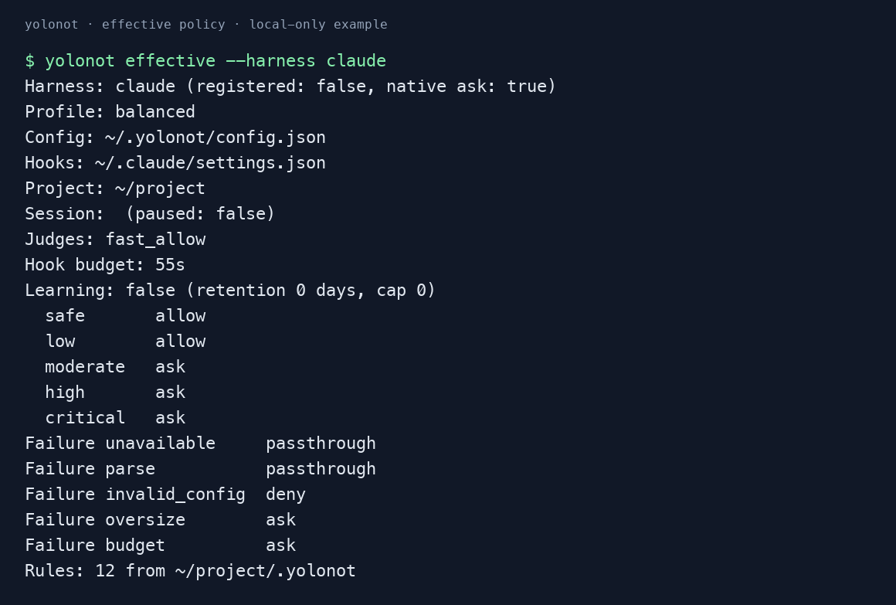

<p align="center">
  
</p>

<h1 align="center">yolonot</h1>

<p align="center">
  Configurable command guardrails for AI coding agents.<br>
  One policy engine across Claude Code, Codex CLI, OpenCode, Antigravity, and Cursor.
</p>

<p align="center">
  <a href="LICENSE"></a>
  <a href="https://github.com/sezaakgun/yolonot/actions"></a>
  
</p>

---

yolonot evaluates shell commands before your coding agent runs them. Combine explicit rules, local parsers, external hooks and [model judges](docs/judges.md), then apply a configurable risk policy. Session memory remembers approved commands and rejects repeated denied commands; script approvals track their contents. An optional [escalation model](docs/models.md#escalation-second-opinion-model) reviews uncertain model verdicts before they reach you.

> **Shared policy, host-specific enforcement.** Each harness exposes different hook and approval capabilities. Check [the adapter behavior](docs/harnesses.md) and `yolonot risk <harness>` for the effective action map. Claude Code also has an optional transcript mod.

> Model judgments can be wrong. Use explicit deny rules for commands that must be blocked. yolonot gates shell tool calls; it does not sandbox processes or cover every file, MCP or native tool action. See [security, privacy and failure behavior](docs/security.md).

## Quick start

### 1. Install and configure your harness

```bash
go install github.com/sezaakgun/yolonot@latest

# To install the current source checkout instead of the published tag:
# go install .

# Make sure Go bin is in PATH
export PATH="$PATH:$(go env GOPATH)/bin"

# First-run wizard: hooks + rules + models + judge chain
yolonot setup

# Or target one harness explicitly
yolonot setup --harness codex
```

Targets: `claude`, `codex`, `opencode`, `antigravity` (`agy`), `cursor`. Without a target,
setup installs into detected harnesses. The optional Claude transcript mod
is installed with `yolonot install --harness claude --mod`.

Setup offers chat providers, typed decision models and local endpoints.
Models live in a named [catalog](docs/models.md); an ordered [judge chain](docs/judges.md)
can combine them with `fast_allow` and trusted `exec:` hooks. `yolonot config`
lets you edit the chain, model endpoints, risk profiles and rules.

Upgrading from 0.x? File-based config is read without rewriting it;
`yolonot migrate` writes the 1.x shape. Review the [removed environment
overrides](docs/upgrading.md) before upgrading.

### 2. Restart and inspect the policy

Restart your host CLI or start a new desktop session to load the hooks, then
inspect the effective policy:

```bash
yolonot risk codex                  # use your harness name
yolonot config validate
yolonot doctor --harness codex       # inspect /hooks trust in Codex too
yolonot effective --harness codex
yolonot judges list
yolonot check "git status"          # dry-run without executing the command
```

Shell tool calls now run through [the pipeline](docs/how-it-works.md).

Using Claude Desktop? Configure model API-key variables in **Local → gear**;
terminal exports may not reach its hooks or mod. See the [Desktop credential
caveat](docs/harnesses.md#claude-desktop-model-credentials).

OpenCode V2 has a native plugin integration, including approval prompts.
Google workflows use Antigravity. yolonot Gemini CLI support has been retired;
remove old hooks with `yolonot uninstall --harness gemini`. See the dated [version and verification matrix](docs/harnesses.md).

Choose failure handling, learning/retention and the total decision budget
through settings or [configuration](docs/configuration.md). Native
`approve`, `deny` and `reset` commands work across harnesses. Start from a
reviewed [example config](examples/) and validate it before installation.

An example of `effective` with the local-only configuration (temporary paths
shortened for display; hooks have not been installed in this example):



## Docs

| Topic | File |
|-------|------|
| How the pipeline decides — layers, hook ordering, pausing, dry-run | [docs/how-it-works.md](docs/how-it-works.md) |
| All CLI + `/yolonot` skill commands | [docs/commands.md](docs/commands.md) |
| Configuration, diagnostics, failure policy, learning and session controls | [docs/configuration.md](docs/configuration.md) |
| Editor schema and example configs | [docs/config.schema.json](docs/config.schema.json), [examples/](examples/) |
| `.yolonot` rule files — format, walk-up, messages, redirects, sensitive files | [docs/rules.md](docs/rules.md) |
| Judges — the chain, `fast_allow` internals, Dippy and other hooks, security model | [docs/judges.md](docs/judges.md) |
| Risk tiers — per-harness action policy, overrides | [docs/risk-tiers.md](docs/risk-tiers.md) |
| Risk profiles — `fast`/`balanced`/`strict`/`paranoid` + custom | [docs/risk-profiles.md](docs/risk-profiles.md) |
| Models — catalog, chat providers, typed decision models, env vars, escalation (second-opinion model) | [docs/models.md](docs/models.md) |
| Prompt customization — prose hints or a full `system_prompt` override, plus `prompt verify` | [docs/prompt.md](docs/prompt.md) |
| Upgrading from 0.x — what changed in config.json and the CLI, `yolonot migrate` | [docs/upgrading.md](docs/upgrading.md) |
| Harnesses — install flags, runtime pinning, per-host caveats | [docs/harnesses.md](docs/harnesses.md) |
| Native verification scope and known host limitations | [docs/harnesses.md](docs/harnesses.md#verification-scope) |
| Analytics — `yolonot log`, `stats`, `suggest`, quiet mode | [docs/analytics.md](docs/analytics.md) |
| Eval suite — test prompt quality across models | [docs/eval.md](docs/eval.md) |
| Architecture — code layout, data directory | [docs/architecture.md](docs/architecture.md) |
| Security scope, trusted configuration, privacy and failure behavior | [docs/security.md](docs/security.md) |

## Uninstall

```bash
yolonot uninstall    # removes hooks + skill, preserves data
```

Data at `~/.yolonot/` is preserved. Delete manually if wanted.

## Acknowledgements

The built-in `fast_allow` judge is heavily inspired by [**Dippy**](https://github.com/ldayton/Dippy) by Lily Dayton — specifically its `SIMPLE_SAFE` allowlist, subcommand-gating approach for multiplex tools (`git`, `docker`, `kubectl`, …), and its hostile-input test corpus. yolonot ports the allowlist tables into Go and re-walks the AST via [`mvdan.cc/sh`](https://github.com/mvdan/sh) instead of Dippy's hand-written Python bash parser (Parable). Where yolonot's parser reaches ambiguity it defers to the LLM — a fallback Dippy doesn't rely on — so the Go port can be stricter (reject-to-LLM) without hurting UX. The `dippy_parity_test.go` corpus and the rules system owe a direct debt to the Dippy project. MIT-licensed, credited in file headers.

## License

MIT. See [LICENSE](LICENSE).
