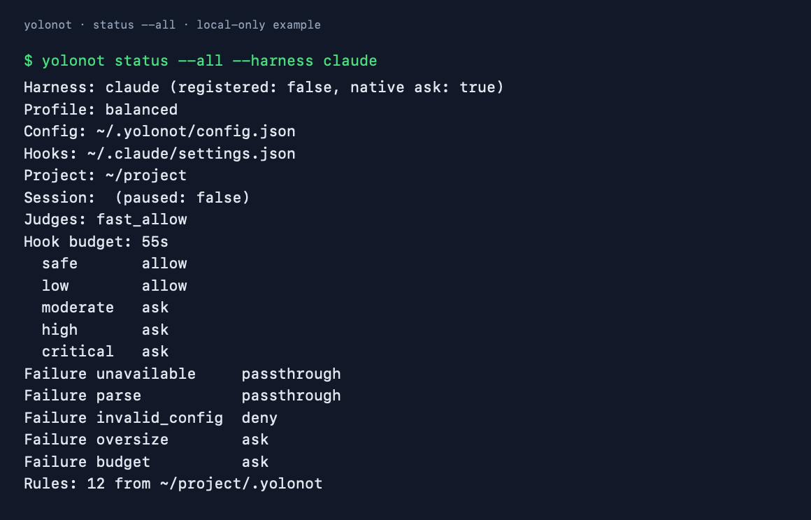

<p align="center">
  <picture>
    <source media="(prefers-color-scheme: dark)" srcset="assets/logo-dark.svg">
    <source media="(prefers-color-scheme: light)" srcset="assets/logo-light.svg">
    
  </picture>
</p>

<p align="center">
  Configurable command guardrails for AI coding agents.<br>
  One policy engine across 24 coding harnesses — Claude Code, Codex CLI, OpenCode, Antigravity, Cursor, Copilot CLI, Qwen, Grok, Kiro, Cline, and more.
</p>

<p align="center">
  <a href="https://yolonot.dev"><strong>yolonot.dev</strong></a> · <a href="https://yolonot.dev/benchmarks">Benchmarks</a> · <a href="https://yolonot.dev/harnesses">Supported agents</a>
</p>

<p align="center">
  <a href="LICENSE"></a>
  <a href="https://github.com/sezaakgun/yolonot/actions"></a>
  
</p>

---

yolonot evaluates shell commands before your coding agent runs them. It combines git-tracked `.yolonot` rules, SHA-256-pinned session memory and on-disk script inspection, a `<1ms` (`~1.6µs`) in-process bash AST parser (`fast_allow`), and pluggable [model judges](docs/judges.md) with optional [Stage 2 escalation](docs/models.md#escalation-second-opinion-model) across four tunable [risk profiles](docs/risk-profiles.md) (`balanced`, `fast`, `strict`, `paranoid` — see [benchmark results](docs/eval.md#published-benchmark-results)).

## Quick start

```bash
# Install via Homebrew (macOS / Linux) or Go
brew install sezaakgun/tap/yolonot
# go install github.com/sezaakgun/yolonot@latest

# Auto-detect installed harnesses and wire hooks, models & judge chain
yolonot setup

# Import existing permissions from Claude, Cursor, Codex, OpenCode, etc. into .yolonot
yolonot rules discover
```

Inspect or tune your active policy anytime:

```bash
yolonot status --all                # active profile, judge chain, rules & hooks
yolonot check "git status"          # dry-run a command through the full pipeline
yolonot profile use fast            # switch between balanced, fast, strict, paranoid
yolonot suggest --list              # promote recurring approvals into .yolonot rules
yolonot doctor && yolonot audit     # verify hook health, latency & security rules
```



## `.yolonot` policy

Drop a `.yolonot` file in your repository root (`deny > ask > allow`; evaluated in `<1ms` before any model call):

```ini
allow-cmd  go test*
allow-path scripts/check.sh

ask-cmd    git push*
deny-cmd   *rm -rf /*
sensitive  .env*
```

> **Safety scope:** `allow-cmd` matches single commands only (chaining `&&` or `|` voids static allow); `critical` risk never maps to `allow`; `sensitive` paths and `~/.ssh` / `~/.aws` are never attached to LLM prompts. yolonot gates shell tool calls—it is not an OS sandbox. See [docs/security.md](docs/security.md).

## Docs

| Topic | File |
|-------|------|
| How the pipeline decides — layers, hook ordering, pausing, dry-run | [docs/how-it-works.md](docs/how-it-works.md) |
| All CLI + `/yolonot` skill commands | [docs/commands.md](docs/commands.md) |
| `.yolonot` rule files — format, walk-up, messages, redirects, sensitive files | [docs/rules.md](docs/rules.md) |
| Risk profiles (`fast` / `balanced` / `strict` / `paranoid`) & risk tiers | [docs/risk-profiles.md](docs/risk-profiles.md), [docs/risk-tiers.md](docs/risk-tiers.md) |
| Judges (`fast_allow`, Dippy, LLM council) & model catalog / escalation | [docs/judges.md](docs/judges.md), [docs/models.md](docs/models.md) |
| Eval suite & published benchmark results (`N = 456` + `5,000` real-world calls) | [docs/eval.md](docs/eval.md) |
| 24 supported harnesses — install flags, `--mod`, per-host behavior | [docs/harnesses.md](docs/harnesses.md) |
| Configuration, schema, examples & prompt customization | [docs/configuration.md](docs/configuration.md), [docs/prompt.md](docs/prompt.md) |
| Analytics (`log`, `stats`, `suggest`) & architecture | [docs/analytics.md](docs/analytics.md), [docs/architecture.md](docs/architecture.md) |
| Security scope, privacy, failure behavior & upgrading from 0.x | [docs/security.md](docs/security.md), [docs/upgrading.md](docs/upgrading.md) |

## Uninstall

```bash
yolonot uninstall    # removes hooks + skill, preserves ~/.yolonot/
```

## Acknowledgements

The built-in `fast_allow` judge is inspired by [**Dippy**](https://github.com/ldayton/Dippy) by Lily Dayton (MIT-licensed) — ported to Go on [`mvdan.cc/sh`](https://github.com/mvdan/sh) with reject-to-LLM fallback.

## License

Apache-2.0. See [LICENSE](LICENSE).
